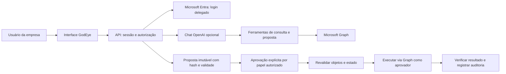

# Arquitetura e fronteiras de confiança

## Tenant e identidade

O tenant vem da identidade Microsoft obtida pelo fluxo authorization code, com PKCE, `state` de uso único e `nonce`. O backend aceita apenas tenants previamente cadastrados e app roles conhecidos. O tenant não é parâmetro dos endpoints de dados nem das ferramentas de IA. Tokens e cache MSAL ficam no servidor. O frontend recebe apenas nome, Object ID, Tenant ID e papéis de sessão.

As consultas usam o token delegado da pessoa conectada. A execução usa o token delegado **do aprovador**, inclusive quando um operador diferente criou a proposta. A conta aprovadora precisa ter os privilégios Microsoft necessários.

Cada registro tem tenant e todos os acessos ao banco filtram esse campo. Isso é isolamento na aplicação, não RLS ou banco dedicado por empresa. O modo demo é local, permite escolher perfis fictícios e é recusado em produção. Bind local é `127.0.0.1` fora de produção.

## Escrita e idempotência

1. O operador fornece UUIDs; o servidor resolve os objetos no tenant atual.
2. O servidor recusa tipos de grupo não suportados e associações já existentes.
3. Salva proposta com estado anterior, tenant, objetos, impacto, solicitante, hash e validade de 15 minutos.
4. O aprovador revisa e envia ID e hash da proposta pelo botão explícito.
5. O backend verifica o papel e reivindica atomicamente a proposta `pending → executing`, em disco, antes de chamar o Graph.
6. Reconsulta usuário, grupo e associação; mudança de nome, login, tipo ou associação invalida a proposta.
7. Envia uma única operação de adição e verifica a associação.

O modelo não recebe uma ferramenta para aprovar, executar, fornecer token ou escolher outro tenant. Uma mensagem de chat dizendo "aprovado" não executa a alteração. A ferramenta de proposta passa pelas mesmas validações e RBAC do formulário.

Resultados: `succeeded`, `pending_verification`, `uncertain`, `stale`, `rejected`. Propostas vencidas continuam com status armazenado `pending`, mas são exibidas como expiradas e recusadas na aprovação. Uma falha depois da tentativa de envio é conservadoramente marcada `uncertain`; não há retry automático. Se o processo morrer após reivindicar a proposta, ela permanece `executing`. Confira a associação no Entra e a auditoria; nunca resete a proposta para `pending` para tentar novamente sem reconciliação.

Não existe transação distribuída entre SQLite e Microsoft Graph. Hash e claim impedem alteração silenciosa e duplicidade local; não garantem compare-and-swap remoto. Pode haver mudanças concorrentes no tenant entre a última verificação e a chamada Microsoft.

## Armazenamento e operação

- Node 24, Express 5 e `node:sqlite` (API ainda pode emitir aviso experimental).
- SQLite local, WAL, uma instância; sessões e dados de domínio cifrados com AES-256-GCM.
- Chave fora do repositório; produção deve obtê-la de armazenamento de segredos. Tenant IDs, IDs de registros, status e timestamps permanecem como metadados não cifrados nas colunas de índice.
- Cookie de sessão HttpOnly, SameSite=Lax, Secure em produção; oito horas; rotação no login.
- Requisições mutáveis exigem `Origin` exato. Sem CORS público, sessão em localStorage ou HTML gerado pelo modelo.
- Interface apresenta dados com `textContent`; não interpreta HTML retornado pela IA ou pelo diretório.
- Headers de segurança, CSP, limites de payload e rate limiting por IP/processo.
- Cache MSAL, sessão, propostas e auditoria persistem no banco; chaves de criptografia precisam permanecer estáveis entre reinícios.
- O template usa uma VM Azure com Docker e volume local no disco gerenciado. Não use SQLite em Azure Files/NFS/SMB, em múltiplos workers ou em várias réplicas. Uma implantação em App Service/Container Apps com escala exige primeiro substituir o banco e as sessões por serviços compartilhados apropriados.

A auditoria registra ator, instante, ação, IDs de proposta/objetos e resultado. Não salva mensagens de chat nem tokens em logs de console. Não é uma trilha imutável contra um administrador do servidor: o administrador com acesso ao banco e chave pode modificar registros. Retenção e exportação WORM são requisitos antes de comercialização.

## Dados enviados ao provedor de IA

Quando a IA está habilitada, a pergunta e os resultados das ferramentas utilizadas podem incluir nomes, logins, grupos, licenças e Tenant ID; esses dados são enviados à API OpenAI para responder. `store:false` evita armazenamento de Responses para recuperação posterior, mas não significa ausência de toda retenção: valem as políticas e controles contratados na API. Informe os clientes e revise suas exigências de residência, retenção e tratamento de dados. Sem IA, as consultas ficam entre a aplicação e a Microsoft.

Cada mensagem é uma execução independente e limitada a seis rodadas de ferramentas; não há memória de conversa no servidor. O histórico visível reside na página atual. Conteúdo do diretório é dado não confiável. As instruções ao modelo reforçam isso; os controles reais de execução são RBAC, validação e aprovação no backend.

## Antes de produção comercial

Migrar SQLite para PostgreSQL com RLS, sessões compartilhadas e execução via fila; adicionar reconciliação de jobs, testes com tenants reais, limites e quotas por organização, autorização contra sessão desatualizada, backup/restauração verificados, retenção por cliente, exportação de auditoria, observabilidade, gestão de consentimento e onboarding administrativo. Revisão independente de segurança e validação de isolamento fazem parte da liberação, não desta demonstração.
